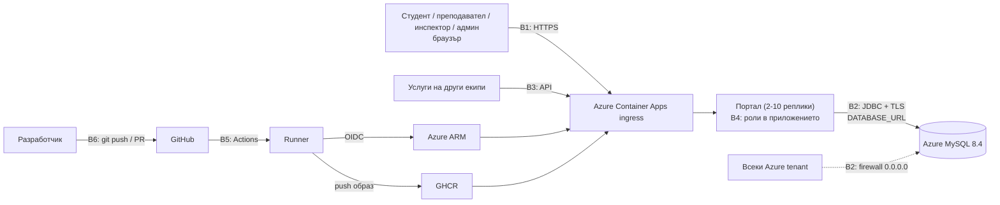

# Модел на заплахите (Threat Model)

| | |
| --- | --- |
| Последна актуализация | 2026-11-11 |
| Преглеждан commit | `57bbc76` (main) |
| Автор | security-engineer агент; преглед: Алекс (Security Engineer) |
| Метод | STRIDE по граници на доверие |
| Поддържа се от | skill `sec-threat-model` |

Моделът покрива и планираната функционалност от седмица 1: регистрация и вход, профили, каталог, записване и разграничаване по роли. Към `57bbc76` в кода има само `/health` и `/`. Затова повечето контроли са „няма още“ и са описани като изисквания (SR-xx), които кодът трябва да изпълни.

## 1. Активи

| # | Актив | Защо е важен | Въздействие при компрометиране |
| --- | --- | --- | --- |
| A1 | Акаунти и пароли (`users.password_hash`, сесии/токени) | Вход от името на друг | Високо |
| A2 | Лични и академични данни: име, имейл, факултетен номер, специалност, курс, статус | GDPR, доверие | Високо |
| A3 | Ролите (`users.role`) и статусът на студента | Основата на целия контрол на достъпа. Другите екипи на UniCloud ги приемат за истина | Критично |
| A4 | Записванията и местата в курсовете | Справедливост в 08:00 | Средно–високо |
| A5 | Достъпност на портала по време на кампанията | Репутация на университета | Високо |
| A6 | Деплой идентичност и тайни: Azure OIDC identity, `GHCR_PAT`, `DATABASE_URL` (MySQL admin) | Пълен контрол над продукцията и базата | Критично |
| A7 | Образът в GHCR и pipeline-ът | Код в продукция без преглед | Критично |

## 2. Актьори

| Актьор | Доверие | Бележка |
| --- | --- | --- |
| Анонимен потребител от интернет | няма | ingress е `external` |
| Студент: ACTIVE, INTERRUPTED или GRADUATED | ниско | най-многобройният и най-мотивиран актьор (места в курсове) |
| Преподавател | средно | достъп само до курсовете, които води |
| Инспектор от учебен отдел | високо | управлява статуси, курсове и записвания |
| Администратор | най-високо | управлява роли и акаунти |
| Услуга на друг екип на UniCloud | средно | чете идентичности и записвания |
| Автор на PR от fork | няма | получава read-only токен и няма достъп до тайните |
| Сътрудник с Write достъп | средно | може да пуска workflow от клон (V-01) |
| DevOps с достъп до Azure | високо | |
| Компрометирана зависимост или GitHub Action | няма | supply chain |

## 3. Граници на доверие

- **B1** Интернет → ingress: TLS, публичен достъп.
- **B2** Приложение → MySQL: credentials в `DATABASE_URL`, TLS (`REQUIRED`), firewall правило.
- **B3** Други услуги → API на портала.
- **B4** Роли в приложението: студент ↔ друг студент, студент ↔ преподавател, преподавател ↔ инспектор/админ.
- **B5** PR → runner → GHCR → Azure.
- **B6** Машина на разработчик или Codespace → хранилище.

## 4. Заплахи

Остатъчният риск е оценен при съществуващите контроли (вероятност × въздействие).

### B4: роли в приложението (основният риск за седмица 1)

| ID | STRIDE | Заплаха | Съществуващ контрол | Изискване | Остатъчен риск |
| --- | --- | --- | --- | --- | --- |
| T-01 | I, T | Студент чете или променя чужд профил или записвания, като смени ID в заявката (IDOR/BOLA) | няма още | SR-10, SR-11 | **висок** |
| T-02 | E | При регистрация студент си задава роля TEACHER или ADMIN чрез mass assignment на `role` | няма още | SR-05, SR-12 | **висок** |
| T-03 | E | Преподавател или инспектор си дава по-висока роля, или служител ползва функция извън ролята си | няма още | SR-10, SR-13 | висок |
| T-04 | S | Регистрация с чужд факултетен номер или имейл, преди истинският студент да се е регистрирал | UNIQUE индекси (`uq_students_faculty_number`, `uq_users_email`). Те пречат на дублиране, но не доказват притежание | SR-06 | **висок** |
| T-05 | T | INTERRUPTED или GRADUATED студент се записва въпреки статуса си | правило в README, без код | SR-14 | среден |
| T-06 | T | Състезание за последното място: двама студенти взимат едно и също място | заключването е описано в README и V1, без код | SR-15 | среден |
| T-07 | D, T | Студент със скрипт прави стотици записвания и отписвания и задържа места | няма | SR-16, SR-31 | среден |
| T-08 | I | Преподавател вижда списъци и лични данни на студенти от чужди курсове | няма още | SR-10, SR-13 | среден |
| T-09 | R | Служител сменя роля, статус или записване без следа | няма | SR-27 | среден |

### B1: интернет → портала

| ID | STRIDE | Заплаха | Съществуващ контрол | Изискване | Остатъчен риск |
| --- | --- | --- | --- | --- | --- |
| T-10 | S | Credential stuffing и password spraying, нарочно в 08:00, когато шумът е най-голям | няма | SR-03, SR-04 | **висок** |
| T-11 | I | Изброяване на акаунти чрез съобщенията при вход, регистрация или забравена парола | няма още | SR-04 | среден |
| T-12 | S | Кражба на сесия чрез XSS, липса на `Secure`/`HttpOnly` или session fixation | няма още | SR-07, SR-18, SR-19 | среден |
| T-13 | T | CSRF: действие от името на логнат студент, например отписване от курс | няма още | SR-19 | среден |
| T-14 | T, I | SQL injection в търсене или сортиране на каталога | няма код; документираният шаблон е параметризиран | SR-17 | нисък (при спазване на шаблона) |
| T-15 | T | Stored XSS чрез име, специалност или заглавие на курс | JSON отговори; още няма frontend | SR-18 | нисък–среден |
| T-16 | D | Претоварване в 08:00: скъпи неавтентикирани заявки или изчерпан connection pool (10 × 15 = 150 от 171) | 2–10 реплики, HTTP scale rule, pool ≤ 15 | SR-31, SR-32 | среден |
| T-17 | I | Изтичане на вътрешна информация: stack traces, actuator, версии | няма actuator. `/` и `/health` показват SHA и реплика (H-12) | SR-20 | нисък |

### B3: други екипи на UniCloud

| ID | STRIDE | Заплаха | Съществуващ контрол | Изискване | Остатъчен риск |
| --- | --- | --- | --- | --- | --- |
| T-18 | S | Неавтентикирана или чужда услуга чете идентичности и записвания | API-то още не съществува | SR-21 | висок (когато API-то се появи) |
| T-19 | I | API-то връща повече лични данни, отколкото потребителят на данните реално ползва | няма | SR-22, SR-24 | среден |
| T-20 | T | Другите екипи разчитат на остарели роли или статуси (кеш) и пускат прекъснат студент до изпит | няма | SR-21 | среден |

### B2: приложение → MySQL

| ID | STRIDE | Заплаха | Съществуващ контрол | Изискване | Остатъчен риск |
| --- | --- | --- | --- | --- | --- |
| T-21 | I, T | Изтекъл `DATABASE_URL` дава admin достъп до базата от всеки Azure tenant | случайна парола от около 119 бита, TLS. Firewall-ът пуска всички Azure услуги (V-03) | SR-25, SR-26 | среден (висок заедно с V-01) |
| T-22 | I | MITM между приложението и MySQL, защото сертификатът не се проверява (`sslMode=REQUIRED`) | TLS криптиране | SR-26 | нисък |
| T-23 | T | SQL injection в приложението стига до admin права (DROP, достъп до всички схеми) | няма отделен потребител с най-малко права | SR-25 | среден |

### B5 и B6: pipeline и хранилище

| ID | STRIDE | Заплаха | Съществуващ контрол | Изискване | Остатъчен риск |
| --- | --- | --- | --- | --- | --- |
| T-24 | I, E | Workflow от несляят клон чете `DATABASE_URL` и `GHCR_PAT` (V-01) | `if: main` в същия файл, който клонът може да промени | SR-34 | **висок (за проверка)** |
| T-25 | T | Подмяна на продукционния образ чрез презаписан tag в GHCR (V-02) | няма digest pinning | SR-35 | среден (за проверка) |
| T-26 | T, E | Компрометиран GitHub Action или Maven зависимост | `security.yml` е закрепен по SHA. `deploy.yml` не е | SR-36 | среден |
| T-27 | E | Deploy identity с Contributor може да чете тайни и да управлява MySQL (H-01). Placeholder в OIDC subject (H-02) | OIDC без парола; scope е само resource group-ата | SR-37 | среден |
| T-28 | I | Credentials, commit-нати в публичното хранилище | `.dockerignore`; Trivy secret scan в `security.yml` | SR-28, SR-29 | нисък |
| T-29 | E | Fork PR изпълнява код с права за запис или с тайни | `pull_request` вместо `pull_request_target`; read-only токен за forks | SR-34 | нисък |

## 5. Решения за архитектурата на сигурността

| Решение | Статус | Обосновка |
| --- | --- | --- |
| Само HTTPS на ingress (`allowInsecure=false`), HSTS | изисква се (SR-30) | Container Apps терминира TLS; трябва да се зададе изрично (H-10) |
| Ограничаване на заявките (rate limiting) | изисква се, в приложението (SR-31) | Безплатният план няма WAF и Front Door, затова лимитът е в приложението. Броячите трябва да са общи за репликите (в MySQL) или да има поне лимит на реплика |
| Хеширане на паролите: BCrypt с cost ≥ 12 или Argon2id чрез `DelegatingPasswordEncoder` | изисква се (SR-01) | Колоната `password_hash VARCHAR(255)` поддържа и двата варианта |
| Сесии: stateless токен или споделено хранилище | решение на екипа (SR-07) | Без sticky sessions in-memory `HttpSession` не работи при 2–10 реплики |
| TLS до MySQL с проверка на сертификата (`VERIFY_IDENTITY`) | изисква се (SR-26) | |
| Отделен MySQL потребител за приложението и отделен за миграциите | изисква се (SR-25) | |
| Достъп до MySQL през мрежата: VNet или private endpoint | не е приложимо засега | При безплатния план (B1ms) и Container Apps Consumption VNet integration увеличава сложността и цената. Компенсира се с отделен потребител, силна парола и ротация. Да се преразгледа, ако се появи бюджет |
| Тайни: GitHub environment `production` → Container Apps secrets | изисква се (SR-34) | Key Vault е безплатен в малки обеми, но не е задължителен за седмица 1 |
| MFA за ADMIN и INSPECTOR в портала | изисква се преди служителите да получат права за запис (SR-08) | |
| MFA за GitHub и Azure акаунтите на екипа | изисква се (SR-09) | безплатно |
| IDS/IPS | не е приложимо | PaaS без собствена мрежа; Azure защитава инфраструктурата. Откриването е на ниво приложение (`sec-monitoring`) |
| VPN | не е приложимо | няма вътрешна мрежа, до която да се влиза |
| SIEM | не е приложимо; използват се Log Analytics и alert rules | безплатният вариант; вж. `MONITORING-AND-IR.md` |

## 6. Отворени въпроси

1. Как порталът проверява, че човекът наистина притежава факултетния номер или имейла (T-04)? Възможности: университетска директория, имейл потвърждение до университетски адрес, или одобрение от инспектор преди `enabled = true`.
2. Сесии или JWT (T-12, SR-07)?
3. Как ще се автентикират услугите на другите екипи (T-18)? Предложение: API ключ на услуга в header, read-only, отделен endpoint.
