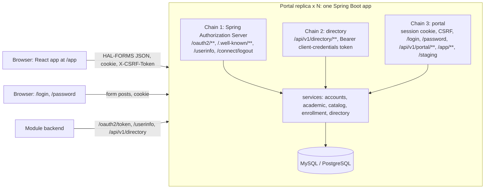

# Design: completing the UniCloud Portal in Java

Status: proposed (2026-11-23), not built. Requirements: [docs/prd.md](../../../docs/prd.md). Decisions: [ADR 0001](../../../docs/adr/0001-keep-the-spring-boot-portal.md), [0002](../../../docs/adr/0002-grow-the-sso-contract.md), [0003](../../../docs/adr/0003-one-cookie-session.md), [0004](../../../docs/adr/0004-react-ui-over-a-hal-forms-api.md). The UI is in the [`react-hypermedia-ui`](../react-hypermedia-ui/design.md) change. What the Java portal sends today: [docs/sso-wire-contract.md](../../../docs/sso-wire-contract.md).

Source: the specs in this folder are taken from the fork's `rust-rewrite` branch (`Alex-Tsvetanov/unicloud-portal`, commit `c16da1a`). The requirements are the same. This design says how the Spring Boot portal meets them.

## Context
`main` (commit `dca60a4`) has:
- Spring Authorization Server as the OIDC provider: authorize with PKCE, single-use codes across replicas, replay revocation, `/userinfo`, logout, the callback rules, hourly cleanup. Pinned by `SsoFlowTests`, `SsoAnyCallbackTests`, `SsoCallbackPolicyTests`, `SsoAuthorizationStoreTests`, `SsoSessionMaxAgeFilterTests`.
- Two logins: the portal's own Bearer JWT (`/api/v1/auth/login`, kept in each tab's `sessionStorage`) and the SSO cookie, bridged by `POST /api/v1/auth/sso-session`.
- Staging tools (`staging/`), on with the `staging` profile.
- Courses, offerings and enrollments as plain REST routes, and static pages (`login.html`, `profile.html`, `courses.html`) that call them.
- Enrollment without overselling: the offering row is locked (`PESSIMISTIC_WRITE`) and enroll and cancel run under READ COMMITTED (PR #14, `EnrollmentConcurrencyTests`).
- Health, `X-Served-By`, graceful shutdown (20 s), Flyway for MySQL and PostgreSQL.

What the specs need and `main` does not have:
- Role `DEAN`, permission bit 10, faculties and specialties as tables, the `faculty` claim.
- One cookie session with a server sign-in page, CSRF, a forced first-password change, Argon2id.
- Permission checks on every handler. Today the course, offering and enrollment routes only need a signed-in user, and `POST /api/v1/enrollments` takes the `studentId` from the body.
- Teacher rejection, the current-semester rule, account creation pages, module registration on a page.
- The `client_credentials` grant with the `directory` scope, and the directory API.
- Narrower discovery, a plain 400 page where the library answers 401 with an empty body, `openid` required in `scope`, `client_id` in the access token.
- The React UI over a HAL-FORMS API (separate change).

## Goals and non-goals
- Goals: meet every requirement in this folder in the existing Spring Boot app. Any replica answers any request; all state is in the database. Keep `docs/sso.md` sections 1 to 10 working for modules, with no new registration. Keep MySQL (production) and PostgreSQL (staging).
- Non-goals: grades, materials, email, self sign-up, single logout, refresh tokens, key rotation, a hand-built OIDC provider, moving production to PostgreSQL, rewriting code that already meets a requirement.

## Architecture



- **Chain 1** stays as it is, with the changes under "SSO provider" below. Its entry point for a browser without a session becomes `/login?sso=1`. It reads the same session as chain 3.
- **Chain 2** is new: an OAuth 2.0 resource server for `/api/v1/directory/**` only. Stateless. It never reads the session.
- **Chain 3** replaces today's stateless API chain. It uses the session (Spring Session JDBC, `__Host-UNICLOUD_SSO`), Spring Security form login and CSRF. It has no JWT resource server any more.
- `ServedByFilter`, `HealthController` and the staging gate stay.

### Packages
New code goes into feature packages under `bg.tusofia.unicloud.portal`:

```text
accounts/      sign-in page, first-password change, Argon2id, staff and student creation
academic/      faculties, specialties, academic records (today: student/)
catalog/       courses and offerings (today: controller/, service/, entity/ CourseController and friends)
enrollment/    enroll, cancel, reject, seat accounting (today: service/EnrollmentService)
access/        Role, Permission, PortalUser (the signed-in user, loaded per request), permission checks
directory/     /api/v1/directory handlers, the client-credentials validator
portalapi/     HAL-FORMS resources for the app (react-hypermedia-ui change)
sso/           as today, plus the discovery customizer and the plain 400 handler
staging/       as today, plus faculty, DEAN and the directory grant
```

A class moves only when its task rewrites it anyway. `user/domain/Role` and `Permission` stay where they are until task 1 touches them.

## Data model

Flyway V5 onwards, each file in `db/migration` (MySQL) and `db/migration-postgresql`, same version and name. A column is dropped only in a release after the code stops using it, so an older replica keeps working during a deploy.

| Table | Change |
|---|---|
| `faculties` | New. `code` (PK, `VARCHAR(16)`, for example `FCST`), `name`. Seeded |
| `specialties` | New. `id`, `faculty_code` (FK), `name` (unique per faculty). Seeded |
| `users` | `role` CHECK gains `DEAN`. New `faculty_code` (FK, null for admins and students), `must_change_password` (default false) |
| `users`, one dean per faculty | PostgreSQL: `CREATE UNIQUE INDEX uq_users_dean_faculty ON users (faculty_code) WHERE role = 'DEAN'`. MySQL has no partial index: a stored generated column `dean_faculty_code = IF(role = 'DEAN', faculty_code, NULL)` with a unique key (MySQL allows many NULLs) |
| `students` | New `specialty_id` (FK). V5 fills it from today's `specialty` text: seeded specialties by name, any other value becomes a new specialty of FCST. The `specialty` text column stays until a later release |
| `courses` | New `faculty_code` (FK). V5 sets FCST for the existing rows |
| `enrollments` | `status` CHECK gains `REJECTED`. New `decided_by` (FK to `users`, null) |
| `oauth2_registered_client` | No schema change. A module with the directory grant gets the `client_credentials` grant type and the `directory` scope in its row |
| `SPRING_SESSION*` | No change. Since V4 they hold the SSO session; now they hold the portal session too |

Faculty of a user: the user's `faculty_code` for teachers, deans and inspectors; for a student, the faculty of the student's specialty; none for admins.

Permissions stay a bitmask in `users.permissions_mask` and a list of names on the wire. Bits 0 to 9 are unchanged. Bit 10 is `STUDENT_PROFILE_READ_FACULTY`. Role defaults (`Role.java`):

| Role | Default permissions |
|---|---|
| `STUDENT` | `STUDENT_PROFILE_READ_OWN`, `COURSE_OFFERING_READ`, `ENROLLMENT_REQUEST_CREATE` |
| `TEACHER` | `COURSE_OFFERING_READ`, `STUDENT_PROFILE_READ_ENROLLED`, `ENROLLMENT_REQUEST_ACCEPT_REJECT` |
| `DEAN` | `STUDENT_PROFILE_READ_FACULTY`, `COURSE_OFFERING_READ` |
| `INSPECTOR` | `STUDENT_CREATE`, `STUDENT_PROFILE_READ_ANY`, `COURSE_CREATE_MODIFY`, `COURSE_OFFERING_READ`, `COURSE_OFFERING_CREATE_MODIFY` |
| `ADMIN` | `STAFF_CREATE` |

The enum order is `ADMIN, INSPECTOR, TEACHER, DEAN, STUDENT`, which is the order the staging API lists them in.

## Key flows

### Sign-in and the session
1. `GET /login` is a Thymeleaf page in Bulgarian. `POST /login` is Spring Security's form login with `email` and `password` and the CSRF field. The email is stripped and lower-cased before the lookup.
2. A wrong email, a wrong password and a disabled user give the same message, "Грешен имейл или парола". An unknown email still runs one password check against a fixed dummy hash, so the answer takes as long as for a real user.
3. On success Spring changes the session id. A success handler stores `LOGIN_AT` (read by the existing `SsoSessionMaxAgeFilter`) and then redirects, in this order: to the saved `/oauth2/authorize` request (the `HttpSessionRequestCache` that chain 1 already uses), to a valid `next` (react-hypermedia-ui spec), or to `/app/`.
4. Passwords: a `DelegatingPasswordEncoder` with `argon2` as the default for new hashes. Hashes without a `{id}` prefix (every hash today) are matched as BCrypt. `UserDetailsPasswordService` rewrites a hash to Argon2id at the next successful sign-in. Module secrets go through the same encoder.
5. `must_change_password`: a filter in chain 3 sends every page except `/password`, `/logout` and static files to `/password`, answers the API with 403 `password_change_required`, and holds back `/oauth2/authorize` (chain 1) the same way. Users from the staging tools are created with the flag off.
6. Every request loads the signed-in user from the database by the id in the session (`PortalUser`). A disabled or deleted user is treated as anonymous at once, and permission changes take effect at the next request. This is one primary-key read per request.
7. `POST /logout` (CSRF protected) invalidates the session, which also ends single sign-on. `/connect/logout` keeps working as today.
8. Hardening (from the fork's security review, now in the specs):
   - **Throttling:** a per-replica map of failures per email (bounded size). 10 failures in 15 minutes lock the email for 15 minutes.
   - **Hashing load:** a semaphore of 4 around the password encoder, so a rush queues instead of using every CPU.
   - **Revocation:** each module login records the session id that created it (the `sid` Spring Authorization Server already puts in the ID token). Sign-out and a password change invalidate those authorizations in `oauth2_authorization`, which `/userinfo` checks.
9. Removed: `AuthController`, `AuthenticationService`, `JwtAccessTokenIssuer`, `SsoSessionController`, `SsoClientController`, the resource-server JWT decoder for `aud=unicloud-api` and `app.jwt.issuer`/`app.jwt.audience`. The RSA key pair (`app.jwt.private-key`, `app.jwt.public-key`) stays: Spring Authorization Server signs with it.

### Permission checks
- `PortalUser` carries the permission names as authorities. Handlers use `@PreAuthorize("hasAuthority('COURSE_CREATE_MODIFY')")`, never `hasRole`. The existing `hasRole('ADMIN') and ...` checks lose the role part.
- Two exceptions the specs make: module registration needs role `ADMIN` (sso-provider spec), and only an admin may create another admin.
- Profile reads (academic-profile spec): `STUDENT_PROFILE_READ_ANY` covers everyone, `STUDENT_PROFILE_READ_FACULTY` the students whose specialty belongs to the reader's faculty, `STUDENT_PROFILE_READ_ENROLLED` the students enrolled in an offering the reader teaches. Otherwise 404.
- Enrollment acts on the signed-in student. The student id never comes from the request.

### Enrollment
Keep PR #14's code path: lock the offering row (`PESSIMISTIC_WRITE`), count `ENROLLED` rows under READ COMMITTED, then insert or re-activate. It works the same on MySQL and PostgreSQL, and `EnrollmentConcurrencyTests` already races the last seats. Additions:
- Only offerings of the current semester accept requests. The current semester is a setting (`app.current-semester`, for example `2026-27-W`).
- A `REJECTED` enrollment is never re-activated: the student cannot enroll in that offering again.
- `reject` (teacher of the offering, `ENROLLMENT_REQUEST_ACCEPT_REJECT`) takes the same lock, sets `REJECTED` and `decided_by`. The place is free because only `ENROLLED` rows are counted.
- Capacity cannot go below the current `ENROLLED` count (same lock).

### SSO provider
Spring Authorization Server stays. Changes, each with a test in `SsoFlowTests` or a new conformance test:
- **Discovery** (`providerConfigurationCustomizer`): list only what is served. `grant_types_supported` `["authorization_code", "client_credentials"]`, `token_endpoint_auth_methods_supported` `["client_secret_basic"]`, `scopes_supported` `["openid", "profile", "email", "unicloud", "directory"]`, no revocation, introspection, device or DPoP entries. The endpoints for those are switched off, so they are not served either.
- **Plain 400 page** (`authorizationEndpoint.errorResponseHandler`): for an unknown `client_id`, a callback the policy refuses, or `response_type` other than `code` when no trusted callback is known. Today the library answers 401 with an empty body (wire contract, "Recorded from the Java staging").
- **`openid` required**: an authorization request validator adds `invalid_request` when `openid` is missing, sent back to the trusted callback.
- **Access token claims** (`OAuth2TokenCustomizer<JwtEncodingContext>`): add `client_id`. `aud` stays the client id as one string.
- **ID token claims**: `SsoUserClaims` gains `faculty` (`{"code", "name"}`) for users who have one.
- **Token types**: the JWS header of access tokens gets `typ: at+jwt` (RFC 9068). ID tokens keep no `typ`, as today.
- **Reserved ids**: `SsoClientRegistrationService` refuses ids that start with `unicloud-` and ids made only of digits.
- **Logout without a hint**: a custom logout request converter shows a Thymeleaf confirmation page (with the CSRF field) when `id_token_hint` is missing or invalid. Only its POST ends the session.
- **Module registration**: the portal API route for admins (react-hypermedia-ui change) calls the existing `SsoClientRegistrationService`. The rules stay as today, plus the `directory` flag. `unicloud-directory` joins `unicloud-api` as a reserved id.

### client_credentials and the directory
- A module with the directory grant is saved with the grant types `authorization_code` and `client_credentials` and the scopes `openid profile email unicloud directory`. Without the grant, it has `client_credentials` too but no `directory` scope, so a request gets `invalid_scope`, as the spec asks (with no `client_credentials` grant type at all the library would answer `unauthorized_client`).
- An authentication validator on the client-credentials provider refuses any scope other than `directory` (`invalid_scope`). No scope sent means `directory` for a client that holds it.
- The token customizer gives client-credentials tokens `sub=<client_id>`, `aud=unicloud-directory`, `scope=directory`, 30 minutes. Spring Authorization Server already stores them in `oauth2_authorization`.
- Chain 2 decodes the JWT with the same JWK source, requires `aud=unicloud-directory` and the `directory` scope, and checks that the stored authorization still exists and is not invalidated. A user-login access token has `aud=<client_id>`, so it gets 401. `/userinfo` refuses a client-credentials token, because it has no user.
- Handlers are GET only. Lists of more than 200 items are paged with `?page=` and a `Link: <...>; rel="next"` header.

| Endpoint | Returns |
|---|---|
| `GET /api/v1/directory/users/{sub}` | `{sub, role, given_name, family_name, name, email, faculty, student}`, the claim shapes |
| `GET /api/v1/directory/users/{sub}/enrollments` | the student's `ENROLLED` offerings `[{id, code, title, semester}]` |
| `GET /api/v1/directory/users/{sub}/offerings` | the teacher's offerings |
| `GET /api/v1/directory/offerings/{id}/students` | `[{sub, name, faculty_number}]` |
| `GET /api/v1/directory/faculties/{code}/offerings` | `[{id, code, title, semester, teacher_sub}]`, `?semester=` |
| `GET /api/v1/directory/faculties/{code}/students` | `[{sub, name, faculty_number, specialty, study_year, status}]` |

### Staging tools
Same routes and shapes as today, plus: `faculty` on users, `DEAN`, 11 permissions, `directory` on module registration. Without the `staging` profile, `/staging` and `/api/v1/staging/**` answer 404 to everyone (today: 401 or 403). The page stays `src/main/resources/staging/index.html` with its own script.

### Security headers, API reference and start-up data
- **Headers**: Spring Security's `headers()` in every chain: the CSP from the operations spec, `nosniff`, `X-Frame-Options: DENY`, `Referrer-Policy: strict-origin-when-cross-origin`.
- **API reference**: springdoc-openapi serves `/openapi.json` and Swagger UI at `/api-docs` (the work of the reverted PR #12, adapted). The SSO endpoints are filters, not controllers, so an `OpenApiCustomizer` adds them by hand. Swagger UI's own script runs from a file, so the CSP needs no inline script.
- **Start-up data**: an `ApplicationRunner` after Flyway. In production: the first admin from `APP_BOOTSTRAP_ADMIN_EMAIL` and `APP_BOOTSTRAP_ADMIN_PASSWORD` if no admin exists, with `must_change_password` set. With `APP_DEMO_PASSWORD` (never in production): demo users of every role, courses and offerings, once. Migration V2's users keep their dummy hashes and cannot sign in.

## Configuration

| Property (variable) | Meaning |
|---|---|
| `spring.datasource.url` (`DATABASE_URL`) | JDBC URL, as today |
| `spring.flyway.locations` (`SPRING_FLYWAY_LOCATIONS`) | `classpath:db/migration-postgresql` on staging, as today |
| `spring.profiles.active` (`SPRING_PROFILES_ACTIVE`) | `staging` turns on the staging tools and callback policy `any` |
| `app.sso.issuer` (`APP_SSO_ISSUER`) | The public `https` origin, as today |
| `app.jwt.private-key`, `app.jwt.public-key` (`APP_JWT_PRIVATE_KEY`, `APP_JWT_PUBLIC_KEY`) | The RSA key pair, as today. Only Spring Authorization Server uses it now |
| `app.sso.allowed-callback-hosts` (`APP_SSO_ALLOWED_CALLBACK_HOSTS`) | Production host list, as today |
| `app.current-semester` (`APP_CURRENT_SEMESTER`) | New. The semester that accepts enrollment, for example `2026-27-W` |
| `APP_BOOTSTRAP_ADMIN_EMAIL`, `APP_BOOTSTRAP_ADMIN_PASSWORD` | New. The first admin in production, created once |
| `APP_DEMO_PASSWORD` | New. Demo data on staging and in development; ignored in production |
| `spring.datasource.hikari.maximum-pool-size` | 15, as today (10 replicas stay under MySQL B1ms's 171) |
| `GIT_SHA`, `HOSTNAME` | `/health` and `X-Served-By`, as today |

## Deployment
- **Docker:** a new first stage builds `web/` with Node (the app and `@unicloud/ui`). The JDK stage copies the built files into `src/main/resources/static/app/` and `src/main/resources/static/ui/v1/` before `./mvnw package`. The jlink runtime and Alpine run stage stay.
- **CI:** `test` (MySQL) and `test-postgres` stay. A new `web` job runs the frontend tests and checks that the generated API types match.
- **Staging and production:** unchanged. Data is kept. Flyway applies V5 and later on the next deploy.

## Testing
- Existing suites keep running. `SsoFlowTests` signs in through `POST /login` with the CSRF field instead of `POST /api/v1/auth/login` plus `sso-session`.
- New: `DirectoryTests` (grant, token rules, every route, paging, 401 and 405), `AccountsTests` (creation rules, first password, BCrypt upgrade, disabled user mid-session), `ProfileAccessTests` (ANY, FACULTY, ENROLLED, 404), `EnrollmentTests` (reject, rejected retry, current semester), `DiscoveryTests` (only served entries), and migration tests on both databases (DEAN check, one dean per faculty, specialty backfill).
- `EnrollmentConcurrencyTests` gains a mixed race: enrolls, cancels and rejects on one offering never exceed capacity.
- Reference for wire shapes: the recording of the Java staging on the fork (`tests/golden/java-staging-2026-11-20.json` on `rust-rewrite`), summarised in `docs/sso-wire-contract.md`.

## Rollout
One branch and one pull request. Each task group in [tasks.md](tasks.md) is its own commit, so the review can go group by group. Before `DEAN` reaches production, module teams are told that `role` may gain values and that an unknown role means no access. No module registers again. The Java frontend pages are replaced in the same release that removes the JWT login, so there is never a release without a working sign-in.

## Risks and trade-offs
- **Spring Authorization Server's defaults** advertise and serve more than `docs/sso.md` promises. Narrowing them touches library extension points that change between versions. Pinned by `DiscoveryTests` and the existing flow tests.
- **One session for the UI and the API** means every portal API call reads the session row. That is more database load at 08:00 than the stateless API had. The pool size and the session table's primary-key reads keep it small; the spike test measures it.
- **Two SQL dialects** for every migration, as today. The partial unique index for deans differs between them (see the data model).
- **Argon2id** costs more CPU per sign-in than BCrypt. Limit concurrent hashes if the spike test shows sign-in queueing.
- **The current semester as a setting** needs a deploy or a variable change at the start of each semester.
