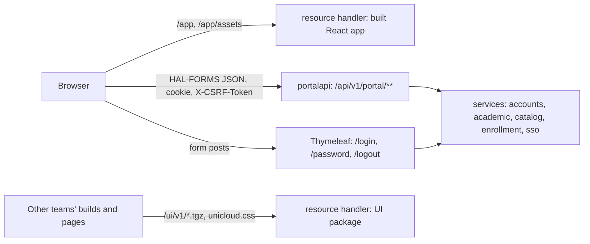

# Design: React UI over a HAL-FORMS API

Status: proposed (2026-11-23), not built. Decision: [ADR 0004](../../../docs/adr/0004-react-ui-over-a-hal-forms-api.md). Backend rules: the [`complete-java-portal`](../complete-java-portal/design.md) change.

## Shape



```text
src/main/java/.../portalapi/   one controller per area, resource models, link and template builders, PortalApiErrors
src/main/java/.../web/         /app fallback to index.html, /ui/v1 with CORS, cache headers
src/main/resources/templates/  login.html, password.html, logout.html, error.html (Thymeleaf)
web/packages/ui                @unicloud/ui 1.0.0, taken over from the fork (commit c16da1a)
web/apps/portal                the app: React Router (basename /app), TanStack Query, a small HAL-FORMS client
```

## Why HAL-FORMS
- The brief asks for hypermedia. With HAL-FORMS the server sends not only data but the links (where the user can go) and the forms (what the user can do, with fields and rules). The app draws what it is given.
- The permission rules live in one place, the server. The app has no role checks, so it cannot show a button the server would refuse, and a new rule needs no app release.
- Spring HATEOAS supports HAL-FORMS out of the box (`MediaTypes.HAL_FORMS_JSON`, affordances on links).

## The API

Media type `application/prs.hal-forms+json`. JSON field names are camelCase, as in the staging API and the Java contract. Entry point `GET /api/v1/portal`:

```json
{
  "user": { "sub": "4", "name": "Александър Стоянов", "role": "STUDENT" },
  "csrfToken": "...",
  "_links": {
    "self":        { "href": "/api/v1/portal" },
    "profile":     { "href": "/api/v1/portal/profile" },
    "courses":     { "href": "/api/v1/portal/courses{?faculty,q}", "templated": true },
    "enrollments": { "href": "/api/v1/portal/enrollments" },
    "offering":    { "href": "/api/v1/portal/offerings/{id}", "templated": true }
  },
  "_templates": {
    "logout": { "method": "POST", "target": "/logout", "properties": [] }
  }
}
```

Link relations from the entry point, each present only with the permission named:

| Relation | Resource | Permission | Templates on it or its items |
|---|---|---|---|
| `profile` | `/api/v1/portal/profile` | signed in | none |
| `courses` | `/api/v1/portal/courses{?faculty,q}`, current semester | `COURSE_OFFERING_READ` | item: `enroll` |
| `offering` | `/api/v1/portal/offerings/{id}` (templated) | `COURSE_OFFERING_READ` | `enroll` |
| `enrollments` | `/api/v1/portal/enrollments` | `ENROLLMENT_REQUEST_CREATE` | item: `cancel` |
| `teaching` | `/api/v1/portal/teach/offerings`, then one offering with its roster | `ENROLLMENT_REQUEST_ACCEPT_REJECT` | roster item: `reject` |
| `student` | `/api/v1/portal/students/{sub}` (templated) | one of the three profile-read permissions | none |
| `faculty` | `/api/v1/portal/faculty`: the dean's offerings and students | `STUDENT_PROFILE_READ_FACULTY` | none |
| `manageStudents` | `/api/v1/portal/inspect/students` | `STUDENT_CREATE` | `create`; item: `changeStatus` |
| `manageCourses` | `/api/v1/portal/inspect/courses` | `COURSE_CREATE_MODIFY` or `COURSE_OFFERING_CREATE_MODIFY` | `createCourse`, `createOffering`; item: `open`, `close`, `changeCapacity` |
| `staff` | `/api/v1/portal/admin/staff` | `STAFF_CREATE` | `create`; item: `enable`, `disable` |
| `modules` | `/api/v1/portal/admin/modules` | role `ADMIN` | `register` |

A template appears only when its action would be allowed now. For example `enroll` needs `ENROLLMENT_REQUEST_CREATE`, an `ACTIVE` student, an open offering of the current semester with a free place, and no `ENROLLED` or `REJECTED` record of this student in it. Every handler checks the same rules again; the template is a hint, not a key.

Form fields come from the server. A `create` template lists its `properties` with `required`, `minLength`, `maxLength`, `min`, `max`, `regex` and, for choices, `options` (Spring HATEOAS `HalFormsConfiguration.withOptions`): faculties, specialties, roles, teachers. Bulgarian labels go in the `prompt` of each property.

**To confirm first (task 1.1):** that the Spring HATEOAS version in Boot 4.1 renders `_templates` on embedded items of a collection. If it does not, each list item carries a link with the action's relation (for example `enroll`), and the form itself is on the item's own resource.

### Errors
- No session: 401 `{"error": "unauthenticated", "message": "..."}`. Never a redirect.
- First password not changed: 403 `password_change_required`.
- CSRF or permission: 403 `forbidden`.
- Validation: 400 `invalid` with `fieldErrors` `[{field, message}]`, the Bulgarian messages the forms show.
- A refused enrollment: 409 with `outcome` (`ALREADY_ENROLLED`, `FULL`, `CLOSED`, `NOT_ACTIVE`, `REJECTED`) and a message.
- The module registration answer, and every error, carry `Cache-Control: no-store`.

### CSRF
Spring Security's CSRF filter with the token in the session (`HttpSessionCsrfTokenRepository`), header `X-CSRF-Token`. The app reads `csrfToken` from the entry point and sends it on every POST, PUT and DELETE. The Thymeleaf pages send it as the `_csrf` field.

## The app
- On start it loads the entry point. Its navigation is the entry point's links, in a fixed order, with Bulgarian names for each relation.
- An app route maps to a relation: `/app/courses` follows `courses`, `/app/students/42` expands the templated `student` link with `sub=42`. The app never writes an API path.
- A generic `<HalForm>` draws a template with `@unicloud/ui` form fields and sends it with the CSRF header. Pages decide the layout; templates decide the fields and whether a button exists.
- On 401 the app does a full page load to `/login?next=/app/<path>`. On `password_change_required` it loads `/password`.
- Types for the resource state (`user`, `offering`, ...) are written in TypeScript next to the client. A Java test (`PortalApiShapeTests`) pins the JSON of each resource and its templates per role, so a change on either side shows up in review.

## Hosting
- `/app/**` serves the built files from `classpath:/static/app/`. Unknown paths get `index.html`, so the app's router decides. `/app/assets/**` never falls back: a missing asset is 404.
- `index.html` is `no-cache`. Hashed assets are cached for a year as immutable.
- `/ui/v1/**` sends `Access-Control-Allow-Origin: *` and `Cross-Origin-Resource-Policy: cross-origin`, cached for an hour. A published version never changes; a new version gets a new file name.
- Content Security Policy `script-src 'self'`. The Vite build has no inline script.

## `@unicloud/ui`
- Copied from the fork's `web/packages/ui` at commit `c16da1a`: the 15 components, the `uc-` stylesheet, the tests and the README. Version stays 1.0.0, so teams that installed it from the fork's staging keep the same package.
- It only draws. It never calls the portal and knows nothing about HAL. The portal app's `<HalForm>` and HAL client live in `web/apps/portal`, not in the package.
- The README names the source commit. Later changes get a new version.

## Build
- `web/` is an npm workspace (`packages/ui`, `apps/portal`), as on the fork.
- Docker: a `node:22-alpine` stage runs `npm ci`, the tests and `npm run build`, and packs the UI package. The JDK stage copies `web/apps/portal/dist` to `src/main/resources/static/app/` and the tarball and stylesheet to `src/main/resources/static/ui/v1/` before `./mvnw package`.
- CI: a `web` job runs `npm ci`, typecheck, Vitest and the build. `./mvnw verify` does not need Node.
- Local: `./mvnw spring-boot:run` for the server and `npm run dev` in `web/` for the app, with Vite proxying `/api`, `/login`, `/logout`, `/password` and `/oauth2` to `localhost:8080`.

## Known gaps
- The first visit downloads the app bundle (React, React Router, TanStack Query and the app). Code splitting per role is not planned yet.
- `@unicloud/ui` is served from the portal, not from an npm registry. A team that needs a registry can mirror the tarball.
- The fork's app talks plain JSON to a different API. Its pages are a reference for the look, not code to copy.
