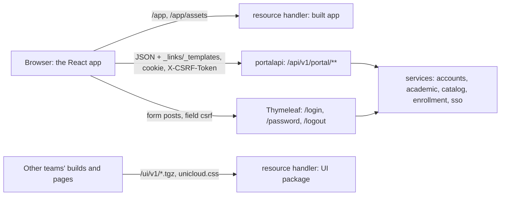

# Design: the React app's JSON API, with hypermedia added

Status: proposed (2026-11-23), not built. Decision: [ADR 0004](../../../docs/adr/0004-react-ui-over-a-hal-forms-api.md). Contract: [portal-api.openapi.json](portal-api.openapi.json). Backend rules: the [`complete-java-portal`](../complete-java-portal/design.md) change.

## Shape



```text
src/main/java/.../portalapi/   one controller per area of the contract, answer records, Hypermedia (links and templates)
src/main/java/.../web/         /app fallback to index.html, /ui/v1 with CORS, cache headers
src/main/resources/templates/  login.html, password.html, logout.html, error.html (Thymeleaf)
web/                           the React app and @unicloud/ui: the UI owner's
```

## The contract

[portal-api.openapi.json](portal-api.openapi.json) is the "Portal UI" part of the fork's `api/openapi.json` at commit `c16da1a`, copied unchanged. It is what the app on staging calls (checked on staging on 2026-11-23: it sends `Accept: application/json`, reads the CSRF token from `GET /me`, sends `X-CSRF-Token` on every change, goes to `/login?next=/app/...` on 401 and to `/password` on `password_change_required`).

| Area | Operations |
|---|---|
| Session | `GET /me` (user, `csrf`, `semester`, `nav`), `GET /options` (faculties, specialties, semester) |
| Profiles | `GET /profile`, `GET /students/{sub}` |
| Catalogue and enrollment | `GET /courses?q=&faculty=`, `POST /courses/{id}/enroll` (200 or 409 `EnrollResult`), `GET /enrollments`, `POST /enrollments/{id}/cancel` |
| Teaching | `GET /teach/offerings`, `GET /teach/offerings/{id}` (offering and roster), `POST /teach/enrollments/{id}/reject` |
| Dean | `GET /faculty` (faculty, semester, offerings, students) |
| Inspection | `GET /inspect/students?q=`, `POST /inspect/students`, `PUT /inspect/students/{sub}/status`, `GET /inspect/courses` (courses, offerings, teachers), `POST /inspect/courses`, `POST /inspect/offerings`, `POST /inspect/offerings/{id}/toggle` |
| Admin | `GET /admin/staff`, `POST /admin/staff`, `POST /admin/staff/{sub}/toggle`, `GET /admin/modules`, `POST /admin/modules` (secret once, `no-store`) |

All paths are under `/api/v1/portal`. Fields are snake_case, except module registration (`clientId`, `redirectUris`, ...), which keeps the staging API's camelCase, as on the fork. Errors are `{error, message}` with `error` one of `unauthenticated`, `password_change_required`, `forbidden`, `not_found`, `invalid`, `conflict`, `server_error`. A refused enrollment is 409 with the same `EnrollResult` as a success; `outcome` is one of `ENROLLED`, `ALREADY_ENROLLED`, `FULL`, `CLOSED`, `REJECTED`, `NOT_ACTIVE`, `NO_SUCH_OFFERING`.

The contract only grows. A change to it is a change to this file first, agreed with the UI owner.

## Hypermedia on top

Each answer keeps its contract fields and gains HAL-FORMS controls, in the HAL-FORMS JSON format, inside the same `application/json` body:

- `_links`: `{"<relation>": {"href": "...", "templated": true?}}`.
- `_templates`: `{"<name>": {"method": "POST", "target": "...", "contentType": "application/json", "properties": [{"name", "prompt", "required", "minLength", "maxLength", "min", "max", "regex", "options"}]}}`.

Where they go:
- **Object answers** (`/me`, `/profile`, `/students/{sub}`, `/teach/offerings/{id}`, `/faculty`, `/inspect/courses`): at the top level.
- **List answers** (`/courses`, `/enrollments`, `/teach/offerings`, `/inspect/students`, `/admin/staff`, `/admin/modules`): on each item. A JSON array has no place for them at the top, and wrapping it would break the contract.
- **Actions on a whole list** (create a student, create staff, register a module): templates of `GET /me`.

| Where | Links | Templates (each only while allowed) |
|---|---|---|
| `GET /me` | `self`; one per `nav` item: `profile`, `courses`, `enrollments`, `teaching`, `faculty`, `students`, `catalogue`, `staff`, `modules`; `student` (templated `/students/{sub}`) for a user who may read other profiles; `options` | `logout` (POST `/logout`, form field `csrf`); `createStudent` (`NewStudent`, specialties as options); `createStaff` (`NewStaff`, roles and faculties as options); `registerModule` (`ClientRegistration`) |
| item of `GET /courses` | | `enroll`: POST `/courses/{id}/enroll` |
| item of `GET /enrollments` | | `cancel`: POST `/enrollments/{id}/cancel`, while `ENROLLED` |
| item of `GET /teach/offerings` | `roster`: `/teach/offerings/{id}` | |
| `GET /teach/offerings/{id}`, each roster entry | `student` | `reject`: POST `/teach/enrollments/{enrollment_id}/reject`, while `ENROLLED` |
| `GET /faculty`, each student | `student` | |
| item of `GET /inspect/students` | `student` | `setStatus`: PUT `/inspect/students/{sub}/status` (`StatusChange`, the three statuses as options) |
| `GET /inspect/courses` | | `createCourse` (`NewCourse`), `createOffering` (`NewOffering`, courses and teachers as options); each offering: `toggle` |
| item of `GET /admin/staff` | | `toggle`, not on the admin's own account |

The rules that decide a template are the ones the handler enforces, in one place: each rule is a method of the service (for example `EnrollmentService.canEnroll(student, offering)`), called both when the answer is built and when the action runs. `enroll` needs `ENROLLMENT_REQUEST_CREATE`, an `ACTIVE` student, an open offering of the current semester with a free place, and no `ENROLLED` or `REJECTED` record of this student in it.

A client that asks for `application/prs.hal-forms+json` gets the same body with that content type.

**Why not Spring HATEOAS:** its models write lists as `_embedded` objects and decide the field layout, which would change the contract. The answers are plain records with the contract's fields, and a small `Hypermedia` helper writes `_links` and `_templates` in the HAL-FORMS format.

## Session, CSRF, errors
- Spring Security's CSRF filter with the token in the session, header `X-CSRF-Token`, form field `csrf` (the name the app's logout form and the server-rendered forms use). The plain token handler, so the value from `GET /me` works on every request of the session.
- No session: 401 `unauthenticated`, never a redirect. First password not changed: 403 `password_change_required`. CSRF or permission: 403 `forbidden`. Validation: 400 `invalid` with a Bulgarian `message`.
- The module registration answer, and every error, carry `Cache-Control: no-store`.

## Server-rendered pages (backend)
- `GET /login`: email, password and the hidden `csrf`, in Bulgarian, no sign-up. `POST /login` honours a waiting SSO login first, then a valid `next`, then `/app/`.
- `GET /password`, `POST /password`: the first-password change.
- `POST /logout`: ends the session; `/connect/logout` without a valid hint shows the confirmation page.

## Hosting
- `/app/**` serves the built files from `classpath:/static/app/`. Unknown paths get `index.html`, so the app's router decides. `/app/assets/**` never falls back: a missing asset is 404.
- `index.html` is `no-cache`. Hashed assets are cached for a year as immutable.
- `/ui/v1/**` sends `Access-Control-Allow-Origin: *` and `Cross-Origin-Resource-Policy: cross-origin`, cached for an hour.
- The portal's Content-Security-Policy (`SecurityHeaders`) already fits the app: its Vite build has no inline script, and inline styles are allowed.

## Build
- `web/` holds the app and `@unicloud/ui`, taken over from the fork at `c16da1a` unless the UI owner keeps them elsewhere (to agree; task 1.2). The UI owner owns it.
- Docker: a `node:22-alpine` stage runs `npm ci`, the tests and `npm run build`, and packs the UI package. The JDK stage copies `web/apps/portal/dist` to `src/main/resources/static/app/` and the tarball and stylesheet to `src/main/resources/static/ui/v1/` before `./mvnw package`.
- CI: a `web` job runs `npm ci`, typecheck, Vitest and the build. `./mvnw verify` does not need Node.
- Local: `./mvnw spring-boot:run` and `npm run dev` in `web/`, with Vite proxying `/api`, `/login`, `/logout`, `/password` and `/oauth2` to `localhost:8080`.

## Moving over
1. The backend serves the contract and the pages while the JWT login and the old static pages still work.
2. The app is served at `/app` and checked against the Java portal (staging, or locally).
3. The old pages and the JWT login are removed (complete-java-portal task 2.6).
4. The UI owner moves buttons and forms to the templates, page by page, whenever it suits them.

## Testing
- `PortalApiContractTests`: every operation, for each role, answers what [portal-api.openapi.json](portal-api.openapi.json) describes (status, required fields, types), checked with a JSON Schema validator in test scope.
- `PortalHypermediaTests`: links and templates per role and per state (an interrupted student gets no `enroll`; a full offering neither; a teacher sees `reject` only on their own roster).
- Permission tests: every template's request, sent by a user without the right, answers 403.
- Hosting tests: `index.html` fallback, missing asset 404, `/ui/v1` CORS.

## Known gaps
- The answers grow by their links and templates. The catalogue is the largest; it stays well under the 1 second goal of docs/slo.md, to be measured by the spike test.
- `@unicloud/ui` is served from the portal, not from an npm registry. A team that needs a registry can mirror the tarball.
